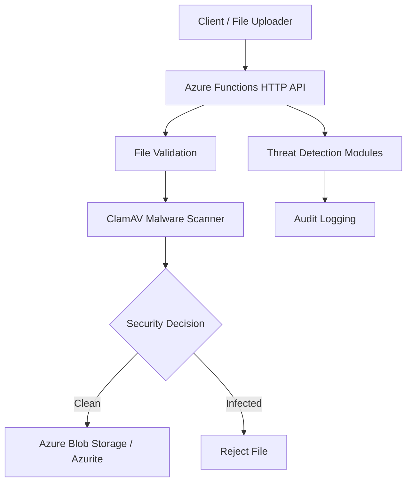

# Azure Secure File Transfer & Threat Monitoring Platform

A containerized, security-focused file ingestion platform built with Azure Functions, Python, Docker, ClamAV, and Azure Blob Storage APIs.

## Project Overview

This project demonstrates secure file ingestion, malware scanning, threat detection, and audit logging using cloud-native development technologies.

The platform has been tested locally using Docker and Azurite, an Azure Storage emulator.

### Project Objectives

- Build secure HTTP-based file ingestion workflows.
- Validate files before acceptance.
- Detect malware using ClamAV.
- Reject infected and duplicate uploads.
- Monitor suspicious authentication and upload activity.
- Maintain audit logs for security investigations.
- Containerize the application for reproducible execution.

## System Architecture



For additional information, see [System Architecture](docs/architecture.md).

## Technology Stack

| Category | Technology |
|---|---|
| Cloud Framework | Azure Functions |
| Programming Language | Python |
| Containerization | Docker |
| Antivirus | ClamAV |
| Storage | Azure Blob Storage API |
| Local Storage Emulator | Azurite |
| Security Monitoring | Python threat detection modules |
| Testing | pytest |
| Version Control | Git and GitHub |

## Implemented Features

### Secure File Upload

The platform provides HTTP-based file ingestion with validation, malware scanning, and storage of accepted files.

### Malware Detection

ClamAV scans incoming files before acceptance.

EICAR antivirus testing confirmed that malware uploads are rejected with HTTP 400.

### Threat Detection Modules

The project includes:

- Authentication threat detection
- Abnormal upload detection
- Malware threat detection
- Suspicious upload activity monitoring

These modules provide threat analysis capabilities. Production alerting and continuous monitoring have not been verified.

### Audit Logging

Audit logging supports security investigations and troubleshooting.

### Docker Containerization

The application uses Docker to package the Azure Functions runtime, ClamAV, and application dependencies.

### Azure Blob Storage Integration

Accepted files are stored using Azure Blob Storage APIs.

Azurite provides local storage emulation.

## API Endpoints

| Method | Endpoint | Description |
|---|---|---|
| GET | `/api/health` | Application health check |
| POST | `/api/upload` | Upload and scan files |
| POST | `/api/validate` | Validate uploaded files |

## Security Testing Results

The following behaviors have been verified locally:

| Test | Result |
|---|---|
| Health endpoint | Passed |
| Clean file upload | Passed |
| File validation | Passed |
| Duplicate upload rejection | HTTP 409 |
| ClamAV EICAR detection | Passed |
| Malware upload rejection | HTTP 400 |
| Malware absent from accepted storage | Verified |
| Selected automated tests | 58 passed, plus 10 subtests |

The complete API and audit logging integration test suite has not yet passed in the isolated test-container environment.

## Local Development

### Prerequisites

- Docker Engine
- Azurite storage emulator
- Git
- Python 3.11 for development outside the container

### Clone Repository

```bash
git clone https://github.com/pty2750/azure-secure-file-transfer-platform.git
cd azure-secure-file-transfer-platform
```

### Build Docker Image

```bash
docker build -t azure-secure-file-transfer:latest .
```

### Runtime Configuration

Configure the application with appropriate environment variables and Azure Storage connection settings.

Do not commit passwords, storage account keys, connection strings containing secrets, or private keys.

A complete independently verified Docker startup guide remains to be finalized.

## Project Documentation

- [System Architecture](docs/architecture.md)
- [Security Design](docs/security.md)
- [Cost Management](docs/cost-management.md)

## Project Status

**Phase 7:** Docker containerization, malware scanning verification, selected automated tests, and GitHub publication completed.

**Phase 8:** Documentation and GitHub portfolio finalization in progress.

The platform has been validated locally. Production Azure deployment has not been verified.

## Future Enhancements

- Deploy the platform to Microsoft Azure.
- Implement Azure managed identities.
- Integrate Azure Key Vault.
- Configure Azure Monitor and security alerts.
- Implement GitHub Actions CI/CD.
- Expand end-to-end integration testing.
- Add container vulnerability scanning.
- Automate infrastructure deployment using Terraform or Bicep.

## Engineering Skills Demonstrated

**Cloud Engineering:** Azure Functions, Azure Blob Storage APIs, cloud application architecture

**DevOps:** Docker, Git, GitHub, containerized development

**Security Engineering:** Malware detection, threat analysis, secure file processing, audit logging

**Software Engineering:** Python, HTTP APIs, modular design, pytest

## Disclaimer

This project is intended for engineering demonstration and portfolio purposes.

Additional integration testing, security review, cloud deployment validation, and operational hardening are required before production use.
